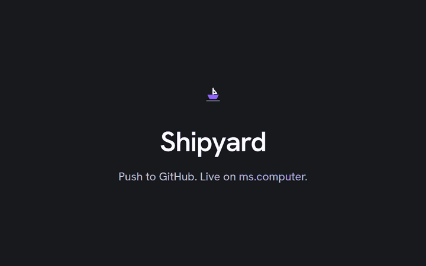

# Shipyard

[](https://shipyard-h0413.ms.computer/#/track/mmdev94/shipyard)

**GitHub → [ms.computer](https://ms.computer), on every push.** Paste a repo — public, or private with GitHub connected — and Shipyard tells you whether it runs on ms.computer and why, scans it for leaked keys, and sets up the GitHub Action that deploys it every time you push. Static sites, Node, Python and Go servers. Then it helps you run it: tracker, roll back, pull request previews, fixes as pull requests, moving a site from GitHub Pages, Netlify or Vercel, and a showcase.

**Live:** https://shipyard-h0413.ms.computer · **Roadmap:** https://shipyard-h0413.ms.computer/#/roadmap



There is no Shipyard server and no account. Everything runs in your browser and in your own GitHub Actions — and this repo deploys itself with the workflow its own checker generates.

## What it does

| | |
|---|---|
| **Check** | Rule-based, in the browser. Detects the framework, build command and output folder; checks every ms.computer limit (static output, no database, no egress, no runtime env vars, file sizes…); scans for leaked keys. Each finding cites the rule and links to the file and line. Checks are pinned to a commit and re-run when you push. |
| **Deploy** | Three ways: one click (a short-lived token held in the tab only), a terminal script for the GitHub CLI (no token touches the page), or by hand on GitHub's own pages. |
| **Templates** | A page, a React app or an Astro blog, committed to a new repo and live in about three minutes. |
| **Track** | Each run step by step, the failure reason in plain words (from public run annotations), the full log, and the live address. |
| **Roll back** | Every deploy on record; put any earlier commit back live at the same address. |
| **Previews** | Opt-in: each pull request from the repo gets its own address, replaced on every push and taken down when it closes. Forks never get one. |
| **Python and Go** | Flask, FastAPI and Go servers (net/http, Gin, Echo, Fiber, chi): the check works out how ms.computer will start them — it guesses `main:app` for Python without a `Procfile` — and catches fixed ports, databases, WebSockets and background jobs. |
| **Fix it for me** | Problems with one safe fix arrive as a pull request with the exact diff: a committed `.env`, a missing `Procfile`, a fixed server port (Node, Python, Go), deep links in single-page apps, a GitHub Pages base path, and Next.js, Nuxt, SvelteKit or Astro builds that can be static. |
| **Move my site** | Repos set up for GitHub Pages, Netlify or Vercel get a move plan — build settings kept, every change and gap spelled out — and one pull request that switches them. *Exact rules* keeps redirects, rewrites and headers by serving the site with Caddy. |
| **Deploy button** | A “Deploy to Ms. Computer” button for any README: visitors get their own copy of the project, live at their own address. |
| **Private repos** | With GitHub connected, checks and fixes read private repos through GitHub's API with your token — never through another server. |
| **My sites** | Every site you deploy: redeploy, update the workflow, switch previews on, take one down. |
| **Showcase** | Every repo tagged `ms-computer` on GitHub, with its live site running in the card. |

## Run your own copy

[](https://shipyard-h0413.ms.computer/#/deploy/mmdev94/shipyard)

Shipyard deploys itself with its own workflow, so the button above gives you your own Shipyard at your own ms.computer address.

## How it stays trustworthy

- **No server.** The page talks only to GitHub; its Content-Security-Policy blocks every other host for API calls.
- **Tokens stay in the tab.** One-click deploy uses a fine-grained token you paste, held in memory — no cookies, no storage, gone on refresh. *What Shipyard did with your token* lists every call made with it, in plain words.
- **Or no token at all.** Terminal mode runs with your own `gh` login on your machine; by-hand mode uses GitHub's pages.
- **The setup token deletes itself.** The first deploy needs one to store the app's key as a repo secret; the workflow deletes it right after.
- **Signed builds.** Every file this site serves is signed at build time ([build provenance](https://docs.github.com/en/actions/security-for-github-actions/using-artifact-attestations)). *Verify this page* on the home page checks the files you're running; for an independent check:

  ```bash
  curl -so index.html https://shipyard-h0413.ms.computer/ && gh attestation verify index.html -R mmdev94/shipyard
  ```

## How deploys work

The generated workflow (`.github/workflows/ms-computer.yml`) builds in the repo's own GitHub Actions and deploys with the official `mscomputer` CLI. The app's identity is kept in repo secrets, and each deploy is recorded as a GitHub Deployment so the next push can replace it at the same address. Pull request previews keep their own app identity encrypted (with a key derived from the main app's secret) in their Deployment record. See `src/lib/workflow.ts`.

## Develop

```bash
pnpm install
pnpm dev     # local site
pnpm test    # 130 tests: checker, fixes, workflow, GitHub flows (against a fake GitHub), and the workflow's own shell
pnpm build
```

The guide clips, the README GIFs (`media/`) and the link-preview image (`public/og.png`) are all drawn by the same React components the site plays (`src/components/clips`). To re-export them: run `pnpm build && pnpm preview --port 4317`, then `node scripts/record-media.cjs <frames-dir>` and `python3 scripts/make-media.py <frames-dir> media`.

Community-built for the ms.computer website competition — not an official ms.computer product. MIT licensed.
